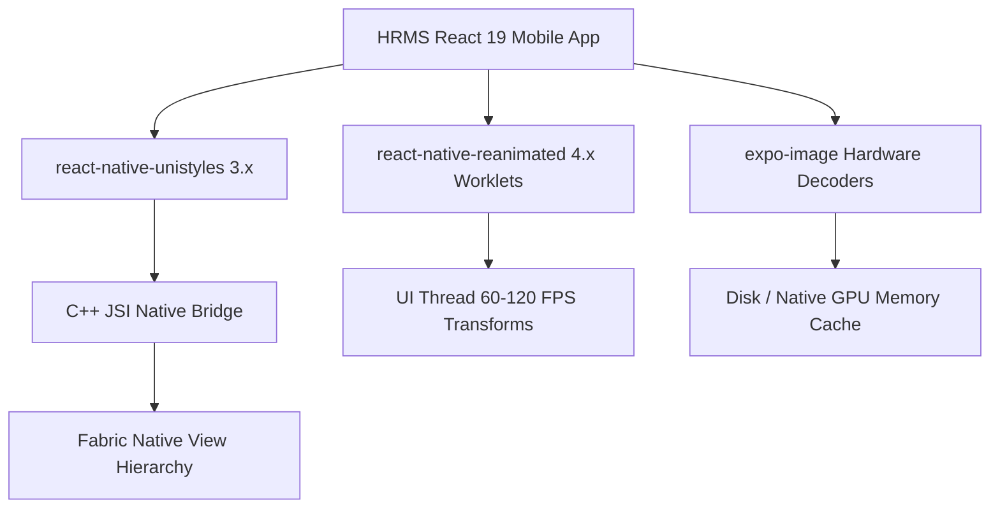

# HRMS Mobile App - Enterprise UI Architecture & High-Performance Styling Guide

## 1. Executive Overview

This specification documents the enterprise UI architecture, styling standards, and memory/rendering optimization guidelines for `hrms-app`.

### Primary Technical Objectives
1. **Sustained 60–120 FPS Rendering**: Smooth interactions and flings on resource-constrained Android devices (e.g., 2GB–3GB RAM, quad-core ARM Cortex-A53, Android 10+).
2. **Zero-Re-render Theme Switching**: Theme changes occur at the C++ JSI layer without cascading JavaScript re-render trees.
3. **Hermes GC Pause Elimination**: Zero inline style object allocations (`style={{ ... }}`) inside render loops, avoiding garbage collection stutters.
4. **Crash-Free Memory Overhead**: Preventing Out-Of-Memory (OOM) fatal errors when viewing feeds with heavy media attachments.
5. **Dual-Script Typography Stability**: Identical bounding-box line heights between English (`Inter`) and Khmer (`InterKhmerLooped`) to eliminate cross-language layout shifts.

---

## 2. 🏛 Core Architecture & Engine Stack



### Why Unistyles 3.x Over NativeWind / StyleSheet
* **C++ JSI Direct Execution**: Unistyles uses direct JSI bindings to modify views at the native engine level without serializing style props across the bridge.
* **Zero Component Re-renders on Theme Change**: When `UnistylesRuntime.setTheme(...)` is invoked, styling updates are applied directly to the native views. React components do not re-render unless explicitly subscribed via `useUnistyles()`.
* **Breakpoints & Orientation**: Handles orientation and split-screen changes natively without JavaScript state listeners.

---

## 3. 🎨 Design System & Theme Engine Rules

### 3.1. Design Tokens (`src/styles/theme.ts`)
All tokens are strictly typed with `as const` and categorized into:
* **Brand Identity**: `brand`, `brandPressed`, `brandSubtle`, `onBrand`.
* **Surfaces**: `background`, `surface`, `surfaceSubtle`, `surfaceSecondary`.
* **Borders & Dividers**: `border`, `borderSubtle`, `borderStrong`, `divider`.
* **Typography**: `textPrimary`, `textSecondary`, `textMuted`, `textDisabled`.
* **Fixed Semantics**: `success`, `warning`, `danger`, `info` (and corresponding `status` sub-tokens with subtle backgrounds and borders).

```typescript
// Strict Theme Token Definition
export const lightTheme = {
  colors: {
    brand: '#DF0000',
    background: '#F8F9FA',
    surface: '#FFFFFF',
    textPrimary: '#111827',
    border: 'rgba(0, 0, 0, 0.07)',
    status: {
      success: '#10B981',
      successSubtle: 'rgba(16, 185, 129, 0.10)',
      // ...
    }
  },
  spacing: {
    xs: 4, sm: 8, md: 12, lg: 16, xl: 20, xxl: 24, screenGutter: 16
  },
  borderRadius: {
    xs: 6, sm: 8, md: 12, lg: 16, full: 9999
  }
} as const;
```

---

## 4. ⚡ Enterprise Performance Rules for Low-End Android

Budget Android devices (MediaTek Helio G35, Snapdragon 665, 2GB–3GB RAM) exhibit severe CPU and memory limitations. To guarantee fluid performance, all components must adhere to the following non-negotiable rules:

### Rule 1: Zero Inline Style Objects in Render Loops (Hermes GC Elimination)
Passing inline objects (`style={{ padding: 16, marginTop: 8 }}`) creates a new JavaScript heap allocation on every single render. When rendering lists or ticking timers, thousands of short-lived objects force Hermes GC sweeps, causing 50–100ms UI freezes.

```tsx
// ❌ CRITICAL ANTI-PATTERN: Forces continuous garbage collection
<View style={{ padding: 16, backgroundColor: theme.colors.surface }}>
  <Text style={{ fontSize: 14, color: '#111827' }}>Label</Text>
</View>

// ✅ ENTERPRISE STANDARD: Static, zero-allocation Unistyles reference
<View style={styles.cardContainer}>
  <AppText variant="body" color="primary">Label</AppText>
</View>
```

### Rule 2: Unistyles Dynamic Variants Over Style Arrays
Avoid allocating style arrays (`[styles.base, isActive && styles.active]`). Use Unistyles **variants**, which resolve at the native layer without array concatenation overhead:

```tsx
// ❌ SLOW: Allocates new array and triggers prop diffing on every render
<View style={[styles.card, isSelected && styles.selectedCard, isError && styles.errorCard]} />

// ✅ ENTERPRISE STANDARD: Clean Unistyles Variants
const styles = StyleSheet.create((theme) => ({
  card: {
    backgroundColor: theme.colors.surface,
    borderRadius: theme.borderRadius.md,
    borderWidth: 1,
    borderColor: theme.colors.border,
    variants: {
      state: {
        default: {},
        selected: {
          borderColor: theme.colors.brand,
          backgroundColor: theme.colors.brandSubtle,
        },
        error: {
          borderColor: theme.colors.status.danger,
          backgroundColor: theme.colors.status.dangerSubtle,
        },
      },
      size: {
        sm: { padding: theme.spacing.sm },
        md: { padding: theme.spacing.md },
        lg: { padding: theme.spacing.lg },
      },
    },
  },
}));

// Usage in Component:
<View style={styles.card({ state: isError ? 'error' : isSelected ? 'selected' : 'default', size: 'md' })} />
```

### Rule 3: Zero `onLayout` Calls Inside List Items
* **Prohibition**: Never attach `onLayout` inside `FlashList` or `FlatList` items to calculate widths or heights.
* **Why**: Every recycled item calculates layout asynchronously on the native thread, dispatches layout events over the bridge, and triggers `setState()`, causing layout thrashing during fast scrolling.
* **Solution**: Compute card dimensions once at the screen level using `useWindowDimensions()` or fixed layout aspect ratios.

```tsx
// ❌ ANTI-PATTERN in list rows:
<View onLayout={(e) => setCardWidth(e.nativeEvent.layout.width)}>

// ✅ ENTERPRISE STANDARD: Compute once or use fixed layout tokens
const { width } = useWindowDimensions();
const cardWidth = width - (theme.spacing.screenGutter * 2);
```

### Rule 4: Zero-Re-render Theme Switching (C++ JSI Pattern)
Do **NOT** call `const { theme } = useUnistyles()` inside components unless dynamic runtime calculation (e.g., SVG canvas prop injection) is unavoidable.

* When a component does **not** call `useUnistyles()`, toggling the theme via `UnistylesRuntime.setTheme(...)` updates the screen **instantly at the C++ level with 0 React re-renders**.
* When text colors are needed, use predefined Unistyles classes or semantic `AppText` color props (`color="primary" | "secondary" | "brand"`).

### Rule 5: Low-End Android Text Rendering (`includeFontPadding: false`)
On Android, the native TextView adds additional top and bottom ascent/descent padding by default (`includeFontPadding: true`). This causes text to appear off-center and clips Khmer subscripts.

* All typography definitions and text components **must** enforce:
```typescript
{
  includeFontPadding: false,
  textAlignVertical: 'center',
}
```

### Rule 6: Hardware-Accelerated Animations (Transforms & Opacity Only)
* **Never** animate layout properties (`width`, `height`, `top`, `left`, `margin`, `padding`). These force native Android `requestLayout()` passes, invalidating the view tree hierarchy.
* **Always** animate `transform: [{ translateX }, { translateY }, { scale }]` and `opacity`.
* Use `react-native-reanimated` Worklets on the UI thread instead of React Native's legacy JS-thread `PanResponder`.

---

## 5. 📜 List Performance Architecture (`@shopify/flash-list`)

Large feeds (`ActivityListScreen`, `HistoryScreen`, `LeaveListScreen`) must strictly implement:

1. **Realistic `estimatedItemSize`**:
   Measure actual pixel height of items in production. An inaccurate estimate causes blank recycling gaps and scroll stutter.
2. **Stable Callback References (`useCallback` / Dispatched IDs)**:
   Never pass arrow functions inside list item rendering (`onPress={() => handleAction(item.id)}`). List item components must receive `item` and a stable handler that accepts the item ID.
3. **Heterogeneous Lists (`getItemType`)**:
   When rendering distinct card types (e.g., Announcement header + Section title + Activity card), specify `getItemType`:
   ```tsx
   <FlashList
     data={data}
     renderItem={renderItem}
     getItemType={(item) => item.type}
     estimatedItemSize={120}
   />
   ```
4. **Memoized Leaf Item Components (`React.memo`)**:
   Wrap every list row component with `React.memo` with a custom equality check or shallow prop comparison.

---

## 6. 🖼 Image Optimization & Memory Management (`expo-image`)

Low-end Android devices have strict per-app heap limits (often 192MB). Unoptimized images will trigger immediate `OutOfMemoryError` crashes.

### Rules for All Images:
1. **Never use standard React Native `Image`**: Always import `Image` from `expo-image`.
2. **Hardware Texture Caching**: Set `cachePolicy="memory-disk"`.
3. **Smooth Crossfade**: Include `transition={150}` to avoid jarring image pops.
4. **Downscale Before Upload**: Scale all captured photos to maximum `1280px` maintaining aspect ratio with `70% JPEG quality` via `optimizeImageForUpload()` in `src/utils/imageOptimizer.ts`.
5. **Disk Cache Cleanup**: Always call `cleanupTempImages()` after uploads finish.

```tsx
// ✅ ENTERPRISE STANDARD Image Rendering
import { Image } from 'expo-image';

<Image
  source={{ uri: imageUri }}
  style={styles.cardImage}
  contentFit="cover"
  cachePolicy="memory-disk"
  transition={150}
  recyclingKey={imageUri}
/>
```

---

## 7. 🌍 Dual-Script Typography Engine (`typography.ts`)

English and Khmer scripts require unified bounding-box metrics to prevent layout jumping when toggling languages.

* **Unified Line-Height Rule**: `khmerLineHeight` is identical to `lineHeight` across all tokens.
* **Script Detection**: Short-circuited by active application locale (`activeLocale === 'kh' ? true : hasKhmerText(children)`).
* **Letter Spacing**: Set to `0` for Khmer text (Khmer vowels/diacritics stack vertically and will break visually if letter spacing is applied).

---

## 8. 🛡 Developer Architecture Checklist (Pre-Commit Gate)

Before submitting any UI component or screen PR, verify:

- [ ] **Unistyles Compliance**: Is the component styled using `StyleSheet.create((theme) => ({ ... }))` from `react-native-unistyles`? (No legacy `StyleSheet.create` from `react-native`).
- [ ] **Zero Inline Objects**: Are there zero inline style objects (`style={{ ... }}`) inside the component body or render loop?
- [ ] **No Inline `onLayout` in Lists**: Are dimensions pre-computed or bound to responsive tokens?
- [ ] **Image Standard**: Does every image use `expo-image` with `cachePolicy="memory-disk"`?
- [ ] **Android Text Padding**: Is `includeFontPadding: false` applied to custom text primitives?
- [ ] **List Recycling**: Does `FlashList` have an accurate `estimatedItemSize`, memoized item component, and stable callbacks?
- [ ] **Haptics & Feedback**: Are key touch actions supported by `expo-haptics` with min 44x44px touch targets?
- [ ] **Light / Dark Parity**: Was the screen verified in both Light Mode (`#F8F9FA`) and Dark Mode (`#121212`)?
